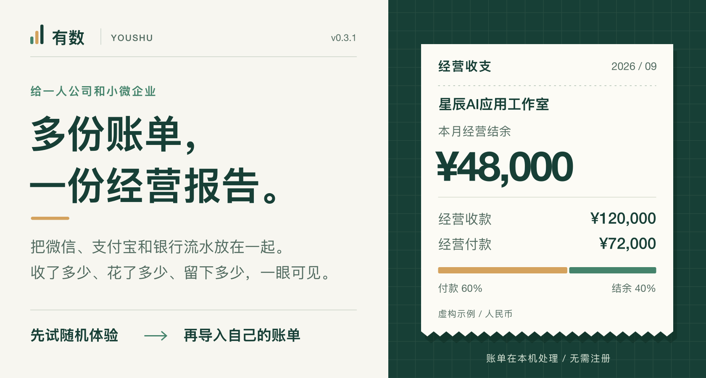
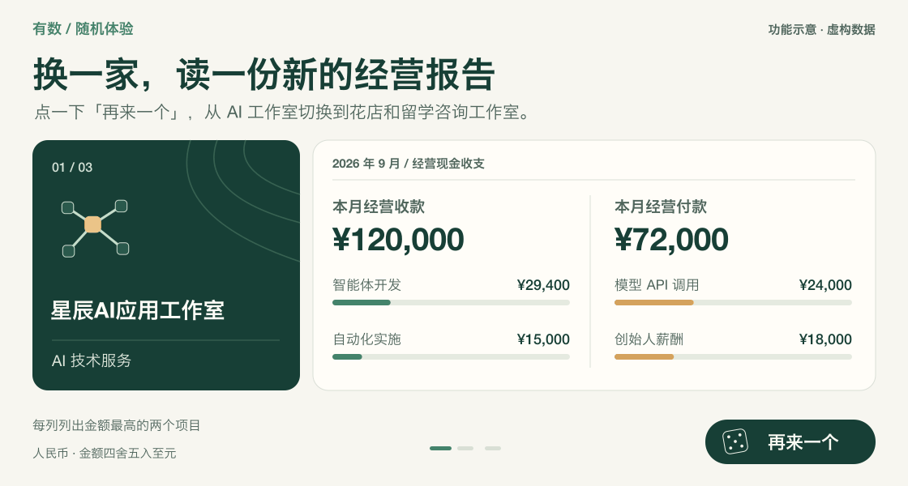
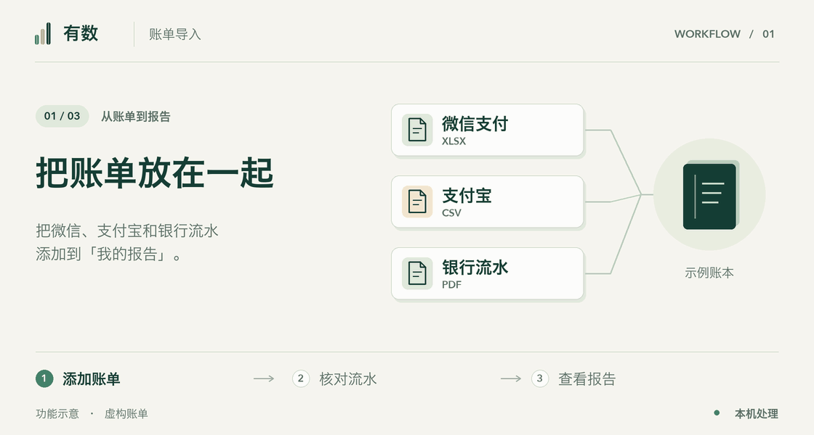
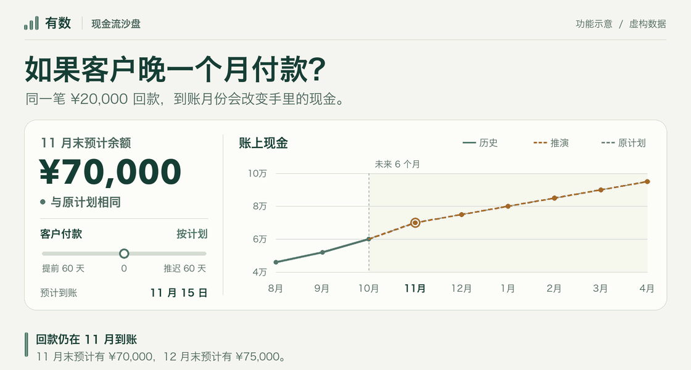
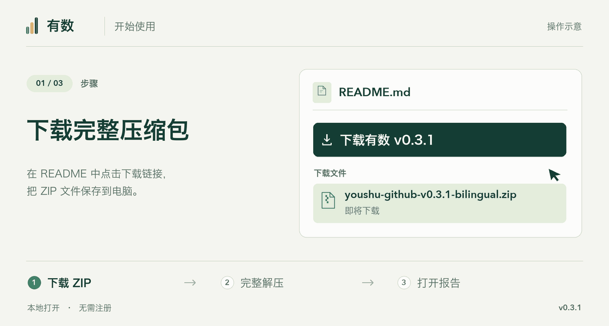
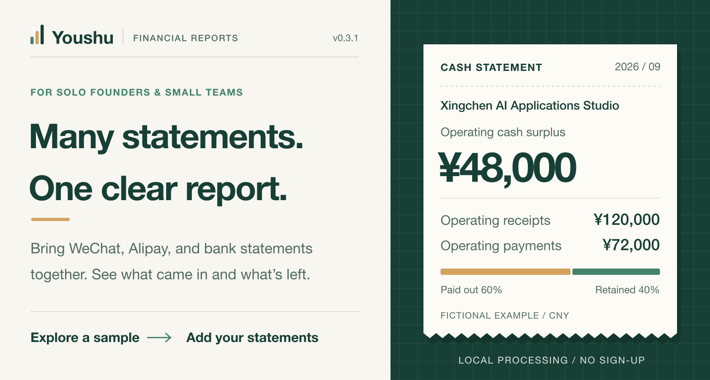
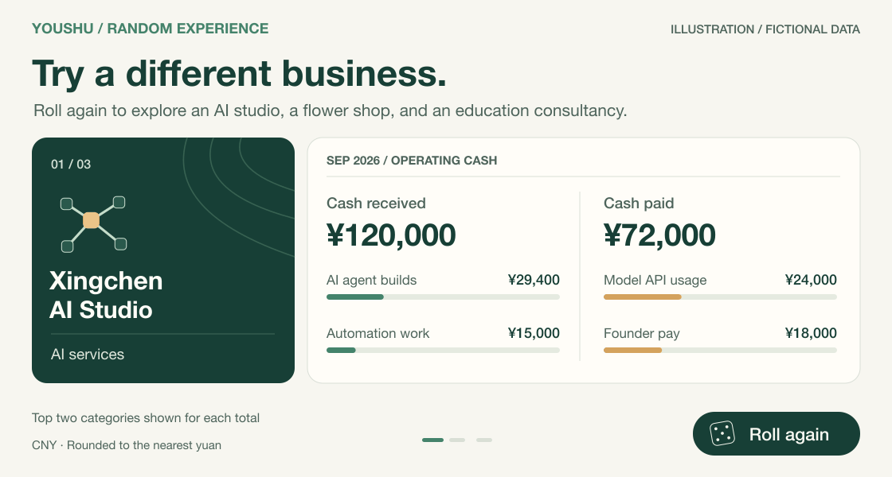
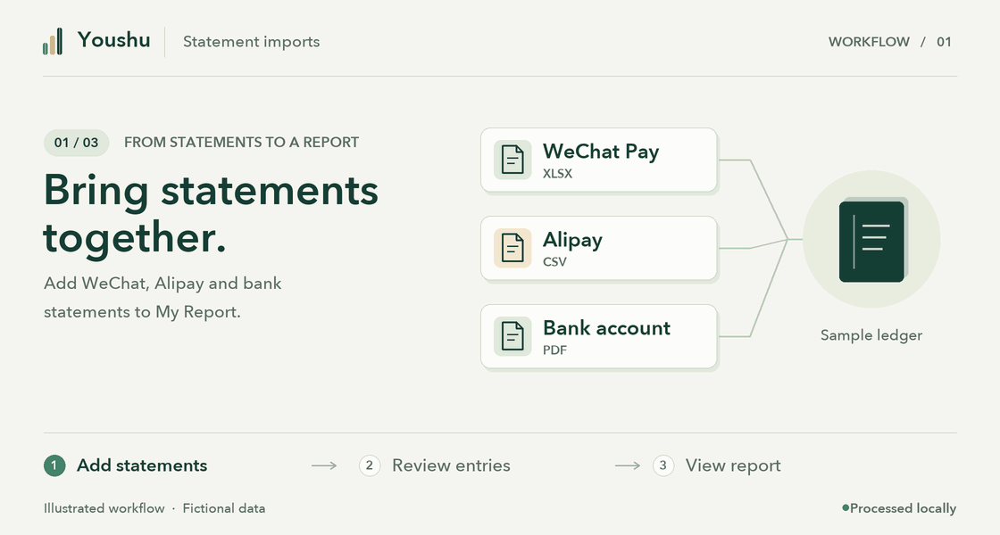
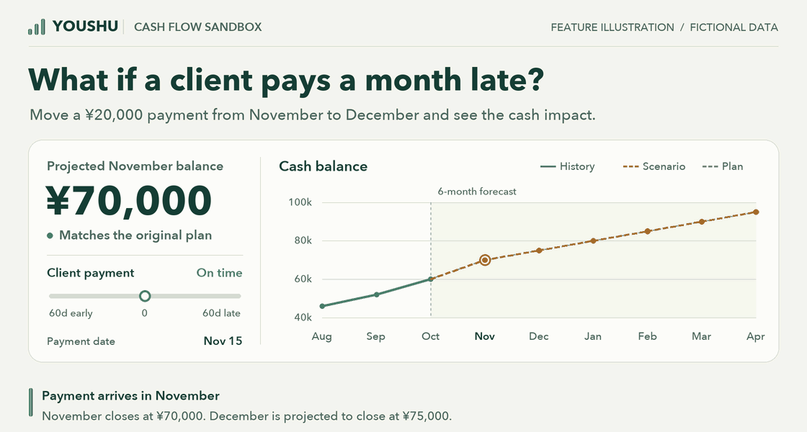
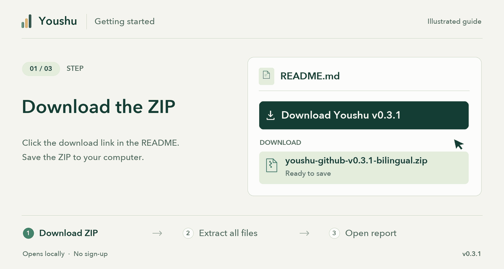

# 有数

[English](#youshu)

**把微信、支付宝和银行账单，变成个性化财务报告。专业还能看得懂！小微企业及OPC个人最佳搭子！**

v0.3.1　·　无需注册　·　账单在本机处理　·　中文界面（人民币）

## 手边没有账单，也能先试

首页右上角有两个入口。**「随机体验」** 可以直接看虚构公司的经营情况，**「我的报告」** 用来导入自己的账单。点一下「再来一个」，就会换一家虚构公司。AI 工作室靠智能体开发收款，成本里有模型 API 调用费。「周五花铺」靠花束销售收款，主要支出则是鲜花与礼品材料。

## 把自己的账单合起来看

进入 **「我的报告」**，添加微信、支付宝或银行账单，按提示核对并生成报告。可以一次添加多份，也可以下个月接着追加。比如两笔收款合计 8,400 元、一笔付款 1,200 元，报告就能把本期 7,200 元的收支结余和对应明细放在一起看。

- **回看某段时间。** 选「全部月份」覆盖整个账本，或选最近 12、6、3、1 个有数据的月份。中间缺月会跳过。
- **追到具体交易。** 点击月度收款柱、付款柱或收入与成本的构成项，查看对应明细。跨平台重复出现的同一笔付款也可以在核对时检查。
- **补齐经营资料。** 有未收回的客户款项，可以补录应收。账单反映现金收支，完整的利润表和资产负债表还需要相应的账务资料。

支持 CSV、Excel 和 PDF。导入银行 PDF 时，请按页核对交易是否齐全，以及日期、收支方向和金额。遇到难以识别的版式或扫描件，可以改用银行导出的 Excel 或 CSV。

## 如果客户晚一个月付款？

在现金流沙盘里拖动 **「客户付款」**，就能比较不同回款时间下未来六个月的预计余额。动图里，一笔 2 万元回款从 11 月推迟到 12 月，11 月末手里的钱就从预计 7 万元降到 5 万元。你也可以调整「收入变化」和「弹性支出」，看看哪些月份需要提前留钱。

## 下载后怎么打开？

**[下载有数 v0.3.1][download]**　·　ZIP 约 9 MB

1. **下载。** 点击上方下载链接，把 `youshu-github-v0.3.1-bilingual.zip` 保存到电脑。
2. **解压。** 在 Mac 上双击 ZIP，在 Windows 上右键选择「全部解压缩」（Extract All）。打开解压后的 `youshu-github-v0.3.1` 文件夹，保留 `index.html`、`assets/` 和 `templates/` 的相对位置。
3. **双击 `index.html`。** 浏览器会先显示「星辰AI应用工作室」的虚构示例报告。点击「再来一个」，可以随机体验另一家公司的示例报告。点击右上角「我的报告」，就能添加自己的账单，开始制作自己的报告。

## 账本保存在哪里？

公开的软件包附带虚构示例和模板。你导入的账单在浏览器中解析，账本保存在本机。看到 **「已保存」** 后，下次在同一浏览器、同一位置打开有数，就能继续使用账本。换电脑、换浏览器、移动软件文件夹或清理浏览器数据前，可到 **「我的报告 → 管理账单」** 下载账本备份。

换设备时，打开有数并恢复 JSON 备份，就能继续编辑账本。HTML 或 PDF 报告用于阅读和分享。需要移除本机记录时，在「管理账单」选择「清空我的报告」并确认。这个操作无法撤销，已下载的备份和原始文件仍保存在电脑上。

[工作流程与计算口径](docs/WORKFLOW.md) · [测试报告](docs/EVALUATION.md) · [部署说明](DEPLOY.md) · [提交历史](Commit%20History.md) · [历史界面截图][screenshots]

维护者为 Yuchen Zhao。项目使用 [MIT 许可证](LICENSE)，随包组件的许可见[第三方声明](assets/vendor/NOTICE.md)。

---

# Youshu

[中文](#有数)

**Turn your WeChat, Alipay, and bank statements into a personalized financial report. Youshu makes professional financial reports easy to read for small businesses and solo founders.**

v0.3.1 · No account required · Statements processed locally · Chinese interface (CNY)

## Explore a business before adding statements

The two buttons at the top right take you to **随机体验 (Explore examples)** and **我的报告 (My report)**. In the examples, click **再来一个 (Another one)** to switch businesses. An AI studio earns money building software agents and pays for model API calls. Friday Flowers sells bouquets and buys flowers and supplies. The report changes with the business.

## Build a report from your own statements

Open **我的报告 (My report)**, add WeChat, Alipay, or bank statements, and review the entries as prompted. Add multiple files at once or append another month later. In the example below, two receipts totaling CNY 8,400 and a payment of CNY 1,200 leave a cash surplus of CNY 7,200. You can trace that total back to the entries.

- **Choose the period.** Select All months or the most recent 12, 6, 3, or 1 months with transactions. The filter skips missing months.
- **Find the underlying entries.** Click a monthly receipts or payments bar, or an income or cost category, to see the matching transactions. Check for a payment that appears on more than one platform when reviewing imports.
- **Add business records as needed.** Enter outstanding customer invoices to track receivables. Statements show cash movements. Complete income statements and balance sheets require supporting accounting records.

Youshu accepts CSV, Excel, and PDF files. For bank PDFs, check that all pages and transactions were read, then review dates, directions, and amounts. If a layout or scan is difficult to read, use the bank’s Excel or CSV export.

## What if a customer pays a month late?

Move the **客户付款 (Customer payment timing)** slider to see how the timing affects your six-month cash forecast. Here, moving a CNY 20,000 receipt from November to December brings November’s projected closing balance down from CNY 70,000 to CNY 50,000. You can also adjust income and flexible spending to see when cash might run short.

## Open your first report

**[Download Youshu v0.3.1][download]** · ZIP, about 9 MB

1. **Download** `youshu-github-v0.3.1-bilingual.zip` to your computer using the link above.
2. **Extract the entire ZIP.** Double-click it on macOS or right-click and choose **Extract All** on Windows. Open the extracted `youshu-github-v0.3.1` folder and keep `assets/` and `templates/` alongside `index.html`.
3. **Double-click `index.html`.** Your browser opens the fictional report for Xingchen AI Applications Studio (星辰AI应用工作室). Select **再来一个 (Another one)** to explore a different sample company at random. To start your own report, select **我的报告 (My report)** at the top right and add your statements.

## Save and restore your ledger

The public package includes fictional examples and templates. Your browser processes imported statements and stores the ledger locally. Wait for **已保存 (Saved)** before closing, then reopen the app from the same location in the same browser to continue. Before switching computers or browsers, moving the app folder, or clearing browser data, download a ledger backup from **我的报告 → 管理账单 (My report → Manage statements)**.

On a new device, open Youshu and restore the JSON backup to continue editing your ledger. Export HTML or PDF to read or share a report. To remove the local ledger, select **清空我的报告 (Clear my report)** in Manage statements and confirm. Clearing the ledger is permanent. Your original files and downloaded backups stay on your computer.

[Workflow and calculation rules](docs/WORKFLOW.md) · [Evaluation](docs/EVALUATION.md) · [Deployment](DEPLOY.md) · [Commit history](Commit%20History.md) · [Earlier interface screenshots][screenshots]

Maintained by Yuchen Zhao. [MIT License](LICENSE) · [Third-party notices](assets/vendor/NOTICE.md)

[download]: https://raw.githubusercontent.com/MirandaZhao/OPC-Auto-Finance-Report/main/youshu-github-v0.3.1-bilingual.zip
[screenshots]: https://github.com/MirandaZhao/OPC-Auto-Finance-Report/blob/0b01624b5bdd5a7957433d5b7bfac73c7359e509/README.md
